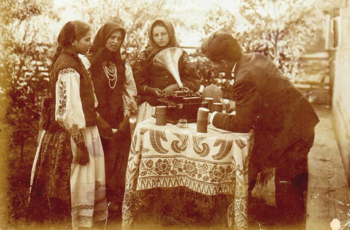
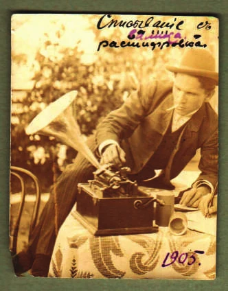

<!-- Текст статьи начинается здесь.
Картинки можно просто перетаскивать в эту папку. -->

<!--more-->
Государственный Российский Дом народного творчества имени В. Д. Поленова (Москва)

**Аннотация.** В статье рассматривается история записей Александра Михайловича Листопадова, сделанных на фонографические валики в ходе музыкально-этнографических экспедиций начала XX в. Особое внимание уделяется количеству и содержанию записанных песен, а также истории архива собранных материалов. Статья основана на доступных источниках и ставит целью собрать воедино все известные факты о коллекции Листопадова.

**Ключевые слова:** А. М. Листопадов, фонографические валики, музыкальная этнография, архив, экспедиции, фольклор, казаки

---

Александр Михайлович Листопадов (1873–1949) — выдающийся российский и советский фольклорист, этнограф и музыковед, известный прежде всего как собиратель и исследователь донских казачьих песен, автор пятитомного труда «Песни донских казаков» (1949–1954). Он посвятил более полувека изучению народного творчества, записав около 1200 песен, и внёс значительный вклад в сохранение казачьей музыкальной культуры.

Пропавший архив А. М. Листопадова, состоявший из его полевых дневников и материалов, записанных им на фонографические валики в ходе экспедиций разных лет на территории области Войска Донского, является источником бесконечных домыслов и легенд. Его поиском с разной степенью успеха занимался сам Александр Михайлович и фольклористы-музыковеды. Эта статья является попыткой обобщить факты, доступные на сегодняшний день: что именно представляло из себя собрание фонографических валиков, сколько их было; что и где было на них записано; известные места хранения архива; пути его перемещения до момента исчезновения.

### ПЕСНИ НА ФОНОГРАФИЧЕСКИХ ВАЛИКАХ

Первые записи на фонограф Александр Михайлович сделал в 1902 г. в ходе совместной с будущим на тот момент писателем и публицистом С. Я. Арефиным экспедиции 1902–1903 гг. по области Войска Донского. В отчёте, который был опубликован в первом томе Трудов Музыкально-этнографической комиссии, он пишет: «Прекрасным пособием, а в некоторых случаях даже единственно возможным для нас средством музыкальной записи служил фонограф, которым записано около сотни напевов» [5. С. 165]. Т. С. Рудиченко отмечала, что А. М. Листопадов записывал на фонографические валики далеко не всех исполнителей: это были малознакомые ему песенные традиции (малороссы, калмыки), либо интересные музыкальные явления (необычное интонирование в хуторе Юрове), либо лучшие исполнители — запевала или дискант. Такой подход удивляет Татьяну Семёновну, и она определяет это как «фиксацию периферийных для темы экспедиции явлений» [11. С. 154]. К её словам необходимо добавить, что выборочная запись применялась, возможно, потому, что фонограф обладал рядом существенных ограничений: узкий частотный диапазон, особенно в верхних частотах, и низкая чувствительность к источнику звука, для прослушивания и тем более расшифровки запись получается удовлетворительной преимущественно у молодых певцов с громкими и чистыми голосами. Таковых оказалось меньшинство, поскольку главной установкой экспедиции была запись «старинных казачьих песен» [5. С. 161] «в виду заметного исчезновения их из среды казаков и вытеснения новой песней» [5. С. 161], для чего в каждом населённом пункте выискивались старожилы, которые ещё могли эти песни вспомнить, и их голоса — в силу возраста — чаще всего таким требования не соответствовали.

На период 1902–1908 гг. длительность звучания одного фонографического валика составляла две минуты. Есть вероятность, что в целях экономии песни записывались не целиком, а только два или три куплета с запевом для фиксации напева, с последующей записью полного текста в тетрадь. Косвенно на это указывал сам Александр Михайлович, описав свои первые опыты применения фонографа, когда они с С. Я. Арефиным так увлеклись подбадриванием песениц, смущённых невиданной машиной, что забыли записать тексты, и это послужило одним из обоснований для последующей экспедиции 1904 г. [4. С. 345]. В противовес сказанному выше стоит отметить, что Александр Михайлович уделял особое внимание вариативности пения [5. С. 191] и в определённых случаях мог не ограничиваться записью первых куплетов. Можно предположить, что в этой экспедиции было записано где-то от 50 до 100 фонографических валиков.

Точных сведений о том, что и где было записано на фонографические валики в экспедиции 1902–1903 гг., на сегодняшний день нет¹. «До сего времени мы посетили 6 песенных пунктов: (Исаев, Нижне-Серебряков, Кременской, Усть-Быстрянскую, обе Кундрюченские). Записано в этих местах 34 песни, в числе которых есть несколько замечательных былин. «...». Несколько песен записано нами на валики фонографа довольно удачно» [1. С. 70]. Исключение составляют записи, сделанные в калмыцкой станице Денисовской: «С особенною очевидностью польза фонографа сказалась при записи калмыцких песен. Незнание языка, невозможность отсюда быстрого подведения текста под напев сильно тормозили ход записей. Главную работу фонограф принял на себя, оставалось только разобрать на валике текст и сделать перевод его на русский язык; и, несмотря на фонограф и на помощь двух калмыков-переводчиков, мы за три дня напряжённого труда с утра до поздней ночи успели записать только 17 песен» [5. С. 166].

Немногим больше сведений и о последующих экспедициях: экспедиция 1904 г. — десять песен в хуторе Насонтове [4. С. 345], четыре песни в хуторе Юрове [4. С. 347], двадцать пять песен в слободе Маньковой [4. С. 349]; экспедиция 1905 г. — одна песня в станице Екатерининской [4. С. 348], примерно пять валиков (на основании фотографии) в слободе Маньковой [1. С. 162].

**Итого:**

- 17 песен в станице Денисовской, 1902 г.;
- 10 песен в хуторе Насонтове, 1904 г.;
- 4 песни в хуторе Юрове, 1904 г.;
- 25 песен в слободе Маньковой, 1904 г.;
- 1 песня в станице Екатерининской, 1905 г.;
- ~ 5 валиков в слободе Маньковой, 1905 г.

### АРХИВ А. М. ЛИСТОПАДОВА В НОВОЧЕРКАССКОМ МУЗЕЕ ИСТОРИИ ДОНСКОГО КАЗАЧЕСТВА

По завершении экспедиции 1902–1903 гг. А. М. Листопадову и С. Я. Арефину Донским статистическим комитетом было поручено привести весь материал в порядок, а затем сдать его в собственность комитета [1. С. 39]; в 1904 г. материалы были переданы, согласно постановлению комитета, в Донской музей (ныне Новочеркасский музей истории Донского казачества) [1. С. 74]. Достоверно известно, что помимо нот были переданы также негативы фотоснимков и фонографические валики, на это указывает письмо А. М. Листопадова директору музея от 6 января 1946 г.: «Сорок лет назад, по окончанию музыкально-этнографической экспедиции по Дону, проведённой мной, материалы её, после снятия с них копий, к сожалению, не проверенных и ненадлежаще скреплённых, были оставлены на хранение. Одновременно были оставлены там же фотографические негативы снимков и фонографические валики уникальной ценности» [7. С. 22] (см. ил. 1 и 2). Это был не единственный запрос Александра Михайловича. В 1938 г., во время приезда в Ростов-на-Дону Е. В. Гиппиуса, материалы в Новочеркасском музее, вероятно, уже отсутствовали, это видно из записи в дневнике А. М. Листопадова:

> …27 думали побывать в Новочеркасском музее насчёт моих валиков и фотоснимков, но так устали и он [Е. В. Гиппиус. — К. Ч.], и я, что были довольны, когда выяснили, что переезд будет связан и с многими хлопотами и может быть бесполезной тратой сил и времени².

В следующем году Александр Михайлович делает повторный запрос в музей, об этом он пишет в своём дневнике:

> Посылал в Новочеркасский музей письмо «…Сегодня получил ответ, что там ничего не оказалось /не найдено/ «…». Не найти, значит, там ни моих фотографических снимков /негативов/, ни напевов, ни книг, которые не так давно дал туда³.

То есть материалы из Новочеркасска, вероятнее всего, пропали во время Гражданской войны, и эту часть архива Александра Михайловича постигла участь большинства экспонатов и документов, которые (за исключением особо громоздких предметов) в 1919 г., по приказу атамана Вселенского Войска Донского А. П. Богаевского, были вывезены отступающей армией в Константинополь [2]. Из Константинополя Донской архив был перевезён в Югославию, где хранился под контролем Донской исторической комиссии и уже в 1925 г. по договору между комиссией и Русским зарубежным историческим архивом материалы начали постепенно передаваться на хранение в Прагу [см.: 8. С. 195]. В 1942 г. во время оккупации немцами Чехословакии часть документов по приказу властей была приготовлена для отправки в Германию. Наиболее важные исторические документы, касающиеся Войска Донского, были помещены в сейфы немецкого Военного архива, другая часть была перемещена в Пражский национальный музей. В 1945 г., после победы над нацистской Германией, Чехословакия передала в СССР основную часть, за исключением периодики, но на родине архив подвергся дроблению. Некоторые части были отправлены в областные архивы, часть архива была разделена между ЦГАОР СССР и ЦГАЛИ СССР, часть была засекречена вплоть до 1988 г. [см.: 3]. Среди отправленных в областные архивы частей была и коллекция Новочеркасского музея истории донского казачества, которую возвратили в 1946 г. в числе 2726 предметов [2]. Среди них, по-видимому, и находились рукописи А. М. Листопадова, которые, в свою очередь, в 1981 г. обнаружил М. А. Лобанов [6]. Надо отметить, что все перемещения новочеркасских материалов сыграли злую шутку с музеем донского казачества. Экспонаты и документы имеют тройную маркировку шифров⁴, и музей по сей день испытывает трудности с учётом своих фондов.

### АРХИВ, НЕ ПОПАВШИЙ В МУЗЕЙ

После 1902–1903 гг. А. М. Листопадов уже не сдавал материалы экспедиций на хранение в Новочеркасский музей. В его распоряжении оставались полевые тетради и фонографические валики, записанные в 1904 и в 1905 г., и, возможно, материалы более поздних экспедиций. Всё это хранилось в его квартире в Ростове-на-Дону вплоть до второй оккупации города в июле 1942 г.⁵ В первую оккупацию Листопадовы никуда не выезжали, их район немцам так и не удалось взять под контроль. После пережитого Александр Михайлович через Ростовский отдел по делам искусств пытался отправить свои материалы в более безопасное место. Из вариантов были Пятигорск, Куйбышев (Самара) и Свердловск (Екатеринбург), но попытки так и не увенчались успехом, и в июле 1942 г. Александру Михайловичу и его супруге Надежде Ивановне пришлось спасаться от вражеского наступления на пароходе в станицу Цимлянскую⁶. Эпизод, как Александр Михайлович вёз под бомбёжкой чемодан с рукописями, неоднократно описан в разных статьях. Официально, по документам, Александр Михайлович в Цимлянскую был отправлен в экспедицию⁷, но более вероятно, что отъезд был организован Ростовским отделом по делам искусств с тем, чтобы Листопадовы смогли переждать боевые действия у родственников Надежды Ивановны, уроженки станицы Цимлянской⁸. Листопадовым пришлось сначала несколько недель жить в степи в вырытой Александром Михайловичем землянке, где они первый раз были подвергнуты грабежу наступающими в сторону Сталинграда румынами, воевавшими в составе Вермахта. После очередной бомбёжки, во время которой убило хозяина дома, где поселились Листопадовы, супруги перебрались в станицу Кумшацкую; здесь они неоднократно подвергались грабежу румынами и немцами, но рукописи при этом удалось сохранить. Оккупантов больше интересовали простые бытовые вещи, а не исписанная бумага. Позже супруги всё-таки перебрались в станицу Цимлянскую, откуда, получив известие об освобождении Ростова-на-Дону, первой поехала с разведкой Надежда Ивановна и обнаружила полное разграбление квартиры.

> 26 сентября. Едва успел закончить 4-й текст, — явилась Надя, притащив на плечах некоторый груз. По существу она проделала весь путь от Шахт пешком. Принесла печальные вести из Ростова: квартира наша разгромлена настолько, что Надя нашла излишним хлопотать о её использовании. От нашего имущества не осталось почти ничего: уцелел фонограф, валики все погибли, как и в 1920 году⁹. Исчезло: вся библиотека историко-этнографическая, по донскому казачеству, моя рукопись по истории собирания русской народной песни /историография/, вся литература по фольклору средней Азии, монгольскому и проч., вся библиотека по теории музыки. Исчезла вся бумага нотная и писчая, подготовленная для III, IV и V томов. Потери меня не особенно трогают: мы переживаем время войны; я рад, что Надя возвратилась жива и здорова, если не считать растёртых ног в дороге и понятной усталости от изнеможения¹⁰.

По приезде в Ростов Листопадовы составили очень подробный список пропавших вещей и подали заявление в милицию. В Российском национальном музее музыки сохранилась папка с заявлениями, описями, свидетельствами, связанными со всеми случаями ограбления. В одном из списков Александр Михайлович указывает пропажу рукописей, снимков и валиков.

> Предметы и авторские рукописи уникальной ценности:
> Фонографические валики нарезанные — 50 шт., рыночная стоимость 300 р. — 15000 р.
> Фотографические снимки экспедиционные Листопадова — 80 шт., рыночная стоимость 50 р. — 4000 р.¹¹

Позже часть вещей удалось отыскать у соседей по дому, в числе прочего обнаружился и фонограф, который сейчас хранится в Российском национальном музее музыки. Больше всего Александр Михайлович переживал пропажу личной библиотеки, это сильно затрудняло его работу. Музыкальная и научная литература вряд ли могла заинтересовать соседей, поэтому случались неприятные находки у коллег по музыкальному цеху¹².

Одна из легенд гласит, что Александр Михайлович самолично уничтожил валики. Казалось бы, зачем? Но слухи не появляются просто так. По воспоминаниям Е. А. Дороховой из её личного общения с Е. В. Гиппиусом, Евгений Владимирович не исключал такой возможности. С её слов, он неоднократно высказывал по этому поводу сомнения: «У меня не пропали, а у него пропали!»¹³

Причиной этому был их опыт совместной попытки издания материалов Александра Михайловича, который так и не увенчался успехом. Историю этого несостоявшегося издания описывает в своей статье Т. С. Рудиченко [10], несколько обойдя стороной эмоциональную часть истории: на материалы Листопадова обратил внимание Е. В. Гиппиус и предложил издать 1000 песен под «шапкой» Академии наук. В ходе работы над изданием у Е. В. Гиппиуса, З. В. Эвальд и А. М. Астаховой возник целый ряд вопросов и уточнений, которые отнимали много времени: Александр Михайлович не всегда мог или хотел на эти вопросы отвечать. В своём дневнике Листопадов ругал ленинградских учёных «буквоедами». Е. В. Гиппиус позволял себе довольно продолжительные задержки с ответами на письма Листопадова. В какой-то момент он не отвечал почти три месяца¹⁴, в результате А. М. Листопадов официально отказался от его кандидатуры как редактора, сославшись на пропущенные сроки сдачи материала. Возможно, издание и могло бы в конце концов увидеть свет, но грянула война. В связи с этим А. М. Листопадов, находясь в оккупированной станице Кумшацкой, запишет в своём дневнике.

> Вот когда особенно сказалось мерзкое поведение Гиппиуса! При ином его отношении, своевременно /ещё в 40 году/ вышел бы 1 том. С ним же открылись бы перспективы и на безусловное принятие к печати II тома и других работ. Всё это дало бы такие средства, с которыми мы двинулись бы не до Кумшака, и материально были бы вполне на старость обеспечены. Гиппиус довёл до лишений, он зло посмеялся над нашим возрастом, действиями своими или бездействиями, он издевался в душе над своим же предупреждением Лундину¹⁵, когда в 1939 г. указал ему, что он, Лундин, понесёт ответственность, если не издаст, ибо возраст Листопадова не допускает промедления. Лундин сдался тогда, но сам Гиппиус решил иное — стоит ли спешить, не лучше ли угробить: ведь он в моём издании даже не соавтор, только редактор, да ещё и не фактический¹⁶.

Помимо того что очередная неудачная попытка издания и начавшаяся война подорвали веру Александра Михайловича увидеть при жизни результаты своего труда, совместная работа показала противоречия между ним и ленинградскими специалистами в подходе к фольклорному материалу и то, что авторитет Листопадова в среде молодых учёных оказался не так высок, как в родной Ростовской области. В этом смысле показательна фраза из дневника Александра Михайловича:

> Подвёл статью свою «О складе былин северных и донских» почти к концу и — уже думаю, не напрасно ли возился. Ведь трогать, скажем, «сказительство», тронуть Гильфердинга и современных фольклористов /Андреева, Астахову/ совсем не безопасно: вести борьбу за принципы из ростовской запихайловки, без местной поддержки, — дело и не лёгкое и безнадёжное. Сбить с позиций фольклористов, на которых они мирно почивали почти 100 лет, — задача настолько трудная, что иногда кажется напрасной моя затея. Всё-таки закончу, а там перейду к «Методам», после чего вырешу, можно ли пускать в оборот написанное¹⁷.

Надо отметить, что Александр Михайлович не то что не имел учёной степени и званий, но даже не имел оконченного высшего образования; тем не менее его авторитета хватало для того, чтобы в Ростове-на-Дону он выступал оппонентом на защите кандидатской диссертации по донским былинам¹⁸ и не раз оказывался в роли редактора фольклорных сборников, в частности Ф. В. Тумилевича¹⁹ [12].

Убеждённость в своей правоте появляется вновь, когда ему возвращают рукопись.

> Получена, наконец, сегодня рукопись I тома от Музгиза, но в таком виде, который привёл меня в изумление: ясно стало, что «редактор» метил в соавторы, а потому исправления /не исправления, а недорослевые соображения по тёмным для него вопросам/ свои совла куда и не просили его и куда они не требовались. Всё это стоило хорошего плевка, если бы не лишняя работа, которую Гиппиус закатил мне, и если бы опять не потеря времени на приведение рукописей в должный вид²⁰.

В конечном итоге в качестве редактора Александр Михайлович останавливает свой выбор на Георгии Петровиче Сердюченко — ростовчанине, филологе, лингвисте, далёком от музыкального фольклора человеке, но достаточно авторитетном, сделавшем очень много для семьи Листопадовых, не говоря уже о том, что именно благодаря его участию пятитомник «Песни донских казаков» увидел свет, хоть и не при жизни автора. Конфликт с Е. В. Гиппиусом, недоверие к столичным учёным, собственный статус де-юре — всё это могло послужить возможным мотивом для того, чтобы Листопадов собственноручно уничтожил или скрыл фонографические валики. В те годы последствия публичной критики могли быть очень плачевными, вплоть до заведения уголовного дела. В противовес этой версии нужно привести соображения, что если бы Александр Михайлович хотел избежать препарирования своего труда, то вместе с валиками надо было бы уничтожить и рукописные полевые материалы, чего сделано не было [см.: 9]. Существует ещё два свидетельства того, что некоторое количество фонографических валиков сохранилось к послевоенному периоду. Первое — это запись в дневнике, датируемая 1944 г., когда Листопадовы уже вернулись в свою ростовскую квартиру и какая-либо опасность для них и их имущества уже миновала.

> Сегодня передо мной два фонографических причитанья, больших и сложных, для которых я должен подготовить прежде всего нотную бумагу²¹.

В том, что здесь идёт речь именно о его собственных фонографических валиках, практически нет сомнений, поскольку Листопадов в этот период занимался исключительно своими материалами, старательно избегая любой относящейся к изданию работы. Второе свидетельство — это фотография, сделанная к юбилею Александра Михайловича, для чего был вызван фотограф и этой фотосессии был посвящён практически целый день. Фотография была опубликована И. М. Гегузиным в книге «Влюблённый в песню» [1]: на ней Александр Михайлович Листопадов с супругой Надеждой Ивановной запечатлены в процессе совместной работы, в кадре отчётливо виден раструб фонографа и футляр фонографического валика (см. ил. 3).

### Примечания

¹ Возможно, более точные сведения о количестве и местах записей можно будет выяснить, изучив фонды ГАРО, где сохранилась переписка А. М. Листопадова и С. Я. Арефина со Статистическим комитетом области Войска Донского, касающаяся хода экспедиции 1902–1903 гг.

² РНММ. Ф-147-148. Л. 3 (28.02.1938).

³ РНММ. Ф-147-148. Л. 38 (01.10.1939).

⁴ До революции маркировка осуществлялась шифром фонда и отдельным шифром для экспозиции. В пражском архиве применялась своя система, после передачи в СССР всем материалам также были присвоены новые номера.

⁵ Ростов-на-Дону пережил две оккупации в период Великой Отечественной войны: первая длилась 8 дней в ноябре 1941 г., вторая — семь месяцев, с июля 1942 по февраль 1943 г.

⁶ РНММ. Ф-147-150. Л. 63 (14.07.1942).

⁷ РНММ. Ф-147-525 (листы без пагинации).

⁸ РНММ. Ф-147-239 (листы без пагинации).

⁹ В 1920 г. в Саратове, в доме, где жили Листопадовы, случился пожар, об этом есть упоминания в том же дневнике.

¹⁰ РНММ. Ф-147-150. Л. 148 (26.10.1942).

¹¹ РНММ. Ф-147-526 (листы без пагинации).

¹² РНММ. Ф-147-577 (листы без пагинации).

¹³ В годы Великой Отечественной войны Е. В. Гиппиус находился в Ленинграде, продолжал научную и издательскую деятельность. Лично переносил фонографические валики Фонограммархива в кладовые Эрмитажа. За это был награждён медалями «За оборону Ленинграда» (1943) и «За доблестный труд в Великой Отечественной войне 1941–1945 гг.» (1945).

¹⁴ РНММ. Ф-147-256 (листы без пагинации).

¹⁵ А. Г. Лундин — директор Государственного музыкального издательства «МУЗГИЗ».

¹⁶ РНММ. Ф-147-150. Л. 83 (01.04.1943). Подчёркнуто в тексте рукой Листопадова.

¹⁷ РНММ. Ф-147-150. Л. 41 (29.11.1939).

¹⁸ РНММ. Ф-147-150. Л. 127, 132, 133, 139 (26.11.1944 — 27.04.1945).

¹⁹ Работа носила неофициальный характер, в выходных данных книги А. М. Листопадов не упоминается.

²⁰ РНММ. Ф-147-150. Л. 103 (24.12.1943).

²¹ РНММ. Ф-147-150. Л. 129 (23.11.1944).

### Литература

1. Гегузин И. М. Влюблённый в песню: Биография Александра Михайловича Листопадова — собирателя и исследователя донских казачьих песен. Ростов-на-Дону, 1985.
2. Из истории музея Донского казачества // Официальный сайт Новочеркасского музея истории донского казачества. URL: http://www.novochmuseum.ru/istoricheskaya-spravka.html.
3. Копылова О. Н., Тарбеев В. В. Возвращение истории: Русский заграничный исторический архив в Праге // Российское историческое общество. 2021. URL: https://historyrussia.org/sobytiya/vozvrashchenie-istorii-russkij-zagranichnyj-istoricheskij-arkhiv-v-prage.html.
4. Листопадов А. М. Записи народных песен в 1904 г. С приложением 30 песен // Труды Музыкально-этнографической комиссии, состоящей при Этнографическом отделе Императорского общества любителей естествознания, антропологии и этнографии. М., 1911. Т. 2. С. 341–363.
5. Листопадов А. М. Народная казачья песня на Дону: Донская песенная экспедиция 1902–1903 гг. С приложением 14-ти песен в народной гармонизации и карты пути экспедиции // Труды Музыкально-этнографической комиссии, состоящей при Этнографическом отделе Императорского общества любителей естествознания, антропологии и этнографии. М., 1906. Т. 1. С. 159–218.
6. Лобанов М. А. Новочеркасская рукопись: новое о деятельности А. М. Листопадова // Советская музыка. 1983. № 10. С. 85–89.
7. Лобанов М. А. Нотные записи А. М. Листопадова из Донской песенной экспедиции: (От рукописи к изданию) // Памяти А. М. Листопадова: сб. науч. ст., посв. 120-летию со дня рождения А. М. Листопадова / ред.-сост. Т. С. Рудиченко. Ростов-на-Дону, 1997. С. 15–31.
8. Муромцева Л. П. Зарубежные архивы российской эмиграции // Россия и современный мир. 2016. № 2. С. 189–206.
9. Рудиченко Т. С. Документы
